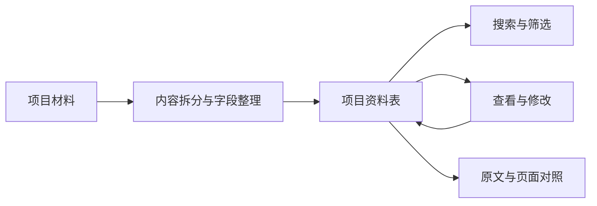
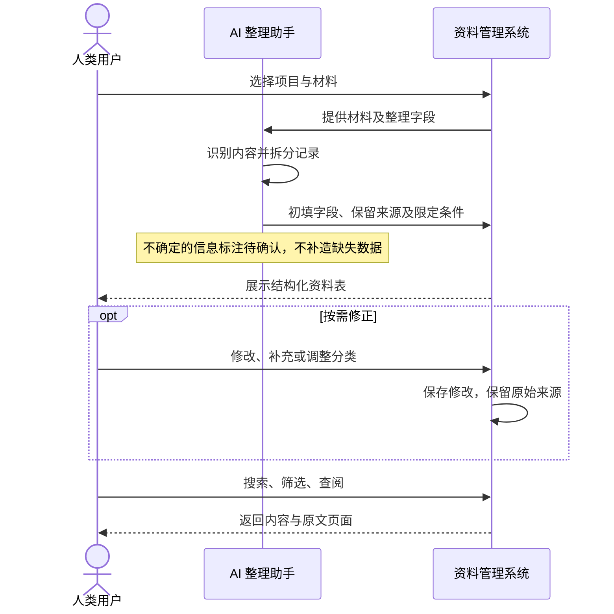

# 城市设计资料整理

一个用于讨论城市设计资料结构化管理的轻量产品原型。将文册中的内容整理成可搜索、可修改、能对照原文的记录，先验证这种组织方式是否有助于日常工作。

**[在线体验](https://zouyu8377-coder.github.io/urban-content-demo/)** · [维护与发布](docs/maintenance.md) · [数据结构](docs/data.md)

新增研究样例：[两个真实项目的三层结构与关系模板](docs/three-layer-examples.md)。包含原文依据、归纳判断、候选归属和可复用表格；尚未接入在线 demo。

## 当前版本

面向浏览者的网页只保留泳道图和实际 demo；设计说明与维护文档放在本仓库。

已支持：

- 切换项目或跨项目搜索，按内容类型筛选。
- 查看和修改记录的名称、类型、所属位置及内容。
- 查看来源文件名、PDF 页码、原文片段和压缩页面预览。
- 在当前浏览器保存修改，刷新后继续使用。

自动上传、AI 提取、多人协作和汇报生成尚未接入。目前的记录是结合真实材料预先整理的选取结果，并非全量导入。

## 设计思路

统一管理五项基础信息：**名称、类型、所属位置、内容、来源**。资料先进入同一张表，用户按需要修正；数据的建议、估算、适用条件和原始出处随内容保留。



## 人、AI 与系统的分工

下图是拟议流程；当前 demo 主要实现资料表及其后的浏览、修改与来源对照。



## 示例材料

| 项目 | 记录数量 | 选取范围 |
| --- | ---: | --- |
| 东莞潮玩文旅 | 14 | B 册 12 个产品策划，以及 A 册 2 项图件说明 |
| 京张 AI 创新带 | 20 | 17 项设施配置、2 项图件说明、1 项设计策略 |

合计 34 条记录，附 18 张压缩页面预览。未上传完整 PDF；分类、摘要与图件用途说明包含本次整理的归纳。数值沿用对应页面口径，不代表已核定结果。

## 代码结构

```text
urban-content-demo/
├── index.html             # 分享入口：泳道图、嵌入式 demo
├── demo.html              # 独立 demo：界面、记录数据、页面预览
├── .nojekyll              # GitHub Pages 直接发布静态文件
├── .gitattributes         # 统一文本文件换行
├── .gitignore             # 排除本地临时文件
├── README.md              # 仓库首页
└── docs/
    ├── data.md            # 字段含义与内容维护约定
    └── maintenance.md     # 预览、更新、发布与检查步骤
```

当前为原生 HTML、CSS、JavaScript，无框架、构建步骤或后端依赖。页面预览以图片数据内嵌在 `demo.html`，运行时无需外部 CDN。

## 本地预览

需要 Git；本地预览可使用 Python 3。

```shell
git clone https://github.com/zouyu8377-coder/urban-content-demo.git
cd urban-content-demo
python -m http.server 8765 --bind 127.0.0.1
```

打开 [本地页面](http://localhost:8765/)。按 `Ctrl+C` 停止服务。

## 更新代码并发布

开始修改前先同步远程代码：

```shell
git pull --ff-only
```

修改后本地预览，确认页面和 demo 正常，再提交：

```shell
git status
git add index.html demo.html README.md docs .gitignore .gitattributes
git commit -m "Describe the change"
git push origin main
```

GitHub Pages 从 `main` 分支根目录发布；推送后自动部署。可在 [Actions](https://github.com/zouyu8377-coder/urban-content-demo/actions) 查看进度，部署完成后使用同一在线地址访问。

**网页中的“保存修改”只写入浏览器本地，不会修改 Git 仓库，也不会发布给其他人。** 要更新所有访问者看到的初始内容，需要修改 `demo.html` 中的数据并提交。细节见 [维护与发布](docs/maintenance.md)。
