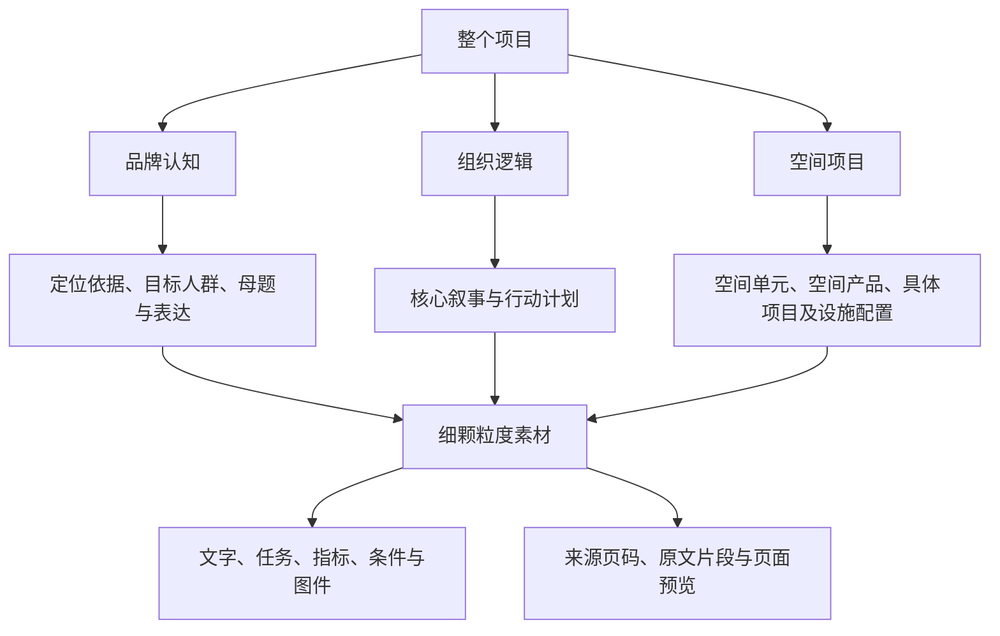

# 城市设计项目内容拆解

一个从整个项目出发，将资料按“品牌认知、组织逻辑、空间项目”三层展开，再拆到细颗粒度素材的产品原型。

**[在线体验](https://zouyu8377-coder.github.io/urban-content-demo/)** · [单独打开 Demo](https://zouyu8377-coder.github.io/urban-content-demo/demo.html) · [维护与发布](docs/maintenance.md) · [数据结构](docs/data.md)

## 当前版本：项目全貌 → 内容对象 → 素材

默认入口为项目全貌。选择东莞或京张项目，可以逐级展开：



图中的线表示组成与拆解。品牌与叙事、行动与项目之间的支撑关系作为独立关联记录，在选中对象后按需展开，不代替项目内容树。

已支持：

- 按三层结构展开分类、内容对象与子项目。
- 从一个对象查看其文字、任务、指标、条件、图件及出处。
- 当前项目内的素材搜索，及辅助素材表视图。
- 修改素材名称、内容、类型和所属对象，保存到浏览器本地。
- 恢复单条素材的初始整理稿。
- 查看部分对象的归纳支撑关系。

自动上传与 AI 提取尚未接入。当前结构与素材由真实材料预先整理，不代表全册已拆解，也未核实方案审定或实施状态。

## 示例范围

| 项目 | 内容对象 | 素材 | 当前范围 |
| --- | ---: | ---: | --- |
| 东莞潮玩文旅 | 28 | 107 | 品牌与组织逻辑选取样例、6 个空间范围记录、12 个空间产品及2个子项目 |
| 京张 AI 创新带 | 33 | 64 | 品牌与组织逻辑选取样例、空间范围、3项空间项目、17项设施配置建议 |
| 合计 | 61 | 171 | 39 张被引用页面的压缩预览 |

“素材”是本次拆分后的管理单元，不等于文档原有条目数量。空间产品与子项目采用父子结构；设施配置建议保持建议性质，不视为已落位的建成设施。

先前的 [三层关系研究样例](docs/three-layer-examples.md) 保留为建模依据，其中23个对象、22条关系是另一组选取的分析样本，与当前页面的内容对象和素材数量不等同。

## 代码结构

```text
urban-content-demo/
├── index.html                    # 分享页：泳道图和实际 Demo
├── demo.html                     # 项目拆解应用入口
├── assets/
│   ├── app.css                   # 结构树、素材与详情样式
│   ├── app.js                    # 展开、检索、编辑、本地保存
│   └── previews/                 # 被引用 PDF 页面的 JPEG 预览
├── data/
│   └── content.json              # 项目、分类、对象、素材与来源数据
├── scripts/
│   ├── prepare-structure-sample.py # 从既有提取缓存准备样例
│   └── render-previews.py         # 用原始 PDF 渲染被引用页
├── docs/                         # 数据说明、维护方式与研究样例
├── .nojekyll
├── .gitattributes
└── .gitignore
```

原生 HTML、CSS、JavaScript，无框架、构建步骤或运行时 CDN。完整 PDF 不在仓库中。

## 本地预览

```shell
git clone https://github.com/zouyu8377-coder/urban-content-demo.git
cd urban-content-demo
python -m http.server 8765 --bind 127.0.0.1
```

打开 [本地分享页](http://localhost:8765/) 或 [独立 Demo](http://localhost:8765/demo.html)。数据通过同源请求载入，需要 HTTP 服务；不要直接双击 HTML 文件。

## 更新与同步

修改前确认工作区情况并同步远程代码：

```shell
git status
git pull --ff-only
```

通常直接编辑 `data/content.json`、`assets/app.js` 或 `assets/app.css`，无需重跑材料整理脚本。本地验证后：

```shell
git add index.html demo.html assets data scripts README.md docs
git commit -m "Describe the change"
git push origin main
```

GitHub Pages 从 `main` 分支根目录自动发布，可在 [Actions](https://github.com/zouyu8377-coder/urban-content-demo/actions) 查看进度。

**页面中的保存只写入当前浏览器，不会同步回 Git 仓库或其他访问者。** 共享默认内容必须修改源码数据并提交。新版使用独立本地存储键，不覆盖旧版演示修改；旧版修改未自动迁移。详见 [数据说明](docs/data.md)。
