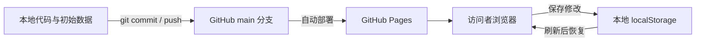

# 维护与发布

## 修改入口

| 要修改的内容 | 文件或位置 |
| --- | --- |
| 分享页泳道图、间距、demo 嵌入方式 | `index.html` |
| demo 布局、搜索、筛选、编辑和原文预览 | `demo.html` 中的样式与脚本 |
| 所有人首次访问看到的记录 | `demo.html` 的 `const initial` |
| 来源文件名 | `demo.html` 的 `const documents` |
| 压缩页面图片 | `demo.html` 的 `const previews` |
| 项目说明和维护方法 | `README.md`、`docs/` |

当前代码是从原型整理出的静态文件，数据、图片和界面尚未拆分。无需安装 npm 依赖，也没有生成脚本需要运行；修改文件后即可预览。

## 代码与演示数据的区别

浏览器修改不会同步回仓库。若未来需要共享修改、多人协作或导出，需要另行实现。

## 推荐更新顺序

1. 在仓库目录运行 `git status`，确认当前工作区情况。
2. 无未提交修改时，运行 `git pull --ff-only` 同步；有修改时先处理本地工作，再拉取。
3. 修改文件，用本地 HTTP 服务预览。
4. 完成下方检查，提交并推送到 `main`。
5. 在 [Actions](https://github.com/zouyu8377-coder/urban-content-demo/actions) 等待部署成功，检查在线页面。

如果拉取报告分叉或冲突，先查看变更并处理，不使用强制推送覆盖远程内容。

## 发布前检查

- 分享页直接展示泳道图和 demo，没有重新加入介绍、沟通引导或反馈区。
- 两个项目能切换；搜索、筛选与翻页结果正确。
- 记录能编辑保存，刷新后可恢复本地修改。
- “对照原文”和“放大页面”能显示对应来源。
- 手机宽度下可使用；泳道图可以横向滚动，页面整体不横向溢出。
- 没有误提交完整 PDF、账号凭据或无关本地文件。

只改 README 或说明文档时，无需重复验证全部界面操作。

## Pages 配置

- 仓库：`zouyu8377-coder/urban-content-demo`
- 来源：`main` 分支，根目录 `/`
- 地址：<https://zouyu8377-coder.github.io/urban-content-demo/>
- `.nojekyll` 保持存在。

部署成功后若仍看到旧页面，可强制刷新；若只看到旧的记录内容，按 [数据说明](data.md#浏览器本地修改) 排查本地演示状态。
