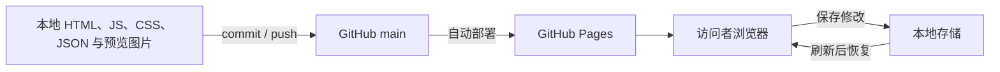

# 维护与发布

## 修改位置

| 要修改的内容 | 位置 |
| --- | --- |
| 分享页泳道图及嵌入方式 | `index.html` |
| Demo 页面入口 | `demo.html` |
| 展开、检索、素材编辑与本地保存 | `assets/app.js` |
| 结构树与素材详情布局 | `assets/app.css` |
| 整个项目、分类、对象、素材、出处与关联 | `data/content.json` |
| 原页面预览 | `assets/previews/` |
| 产品与研究说明 | `README.md`、`docs/` |

静态文件无需编译。页面以同源 `fetch` 载入数据，因此本地应通过 HTTP 服务预览。

## 共享代码与本地修改



网页修改不会回写仓库。公开默认数据由 `data/content.json` 决定。

## 常规更新

1. `git status` 检查工作区；处理已有修改后再 `git pull --ff-only`。
2. 修改数据或代码，在仓库目录运行 `python -m http.server 8765 --bind 127.0.0.1`。
3. 打开 `http://localhost:8765/` 和 `/demo.html` 预览。
4. 完成必要检查后提交并推送到 `main`。
5. 在 [Actions](https://github.com/zouyu8377-coder/urban-content-demo/actions) 等待 Pages 部署成功，再检查线上。

```shell
node --check assets/app.js
git diff --check
git add index.html demo.html assets data scripts README.md docs
git commit -m "Describe the change"
git push origin main
```

## 需要复验的行为

- 默认显示整个项目及三层组成，不退回只看一张资料表。
- 分类、对象、子项目能逐级展开到素材。
- 素材详情有完整路径、内容、整理性质与原文来源。
- 修改名称、类型、内容与所属对象后，树和素材表保持一致。
- 保存、刷新、恢复单条整理稿正常，来源不丢失。
- 图件及普通文字都能查看对应页面；图片没有404。
- 桌面和手机布局无整体横向溢出；分享页仍只包含泳道图和实际 Demo。

只修改说明文档时，不需要重复全部界面测试。

## 可选：重建这一批选取样例

常规维护不需要运行下面的脚本。它们是本次整理的离线辅助工具，尚不构成产品中的自动导入功能。

`prepare-structure-sample.py` 需要此前提取的 `A_pages.json`、`B_pages.json`、`C_pages.json` 与 `real_records.json`；缓存和完整 PDF 均不在仓库中。Python 标准库即可准备数据，渲染图片另需 Poppler 的 `pdftoppm`。

```shell
python scripts/prepare-structure-sample.py --cache-dir PATH_TO_EXTRACTED_CACHE
python scripts/render-previews.py --source-dir PATH_TO_ORIGINAL_PDFS
```

准备脚本会重写 `data/content.json`，因此有手工数据更新时应先检查差异；不要把它当作每次发布必跑的步骤。

## Pages 配置

- 仓库：`zouyu8377-coder/urban-content-demo`
- 来源：`main` 分支，根目录 `/`
- 地址：<https://zouyu8377-coder.github.io/urban-content-demo/>
- `.nojekyll` 保持存在。

新部署后若仍看到旧布局，先强制刷新；若素材内容受本地修改覆盖，可参考 [数据说明](data.md#浏览器本地修改) 或使用无痕窗口。
