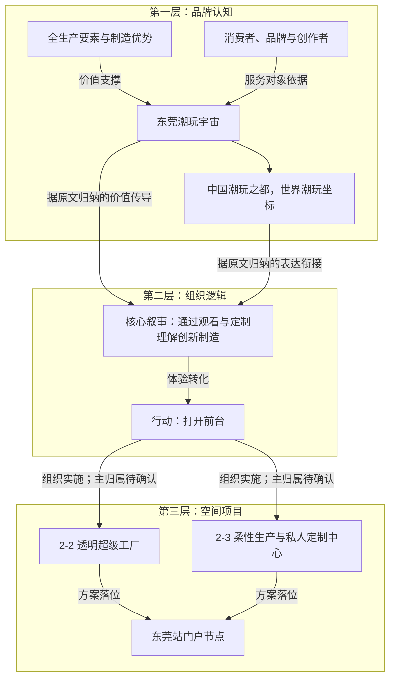
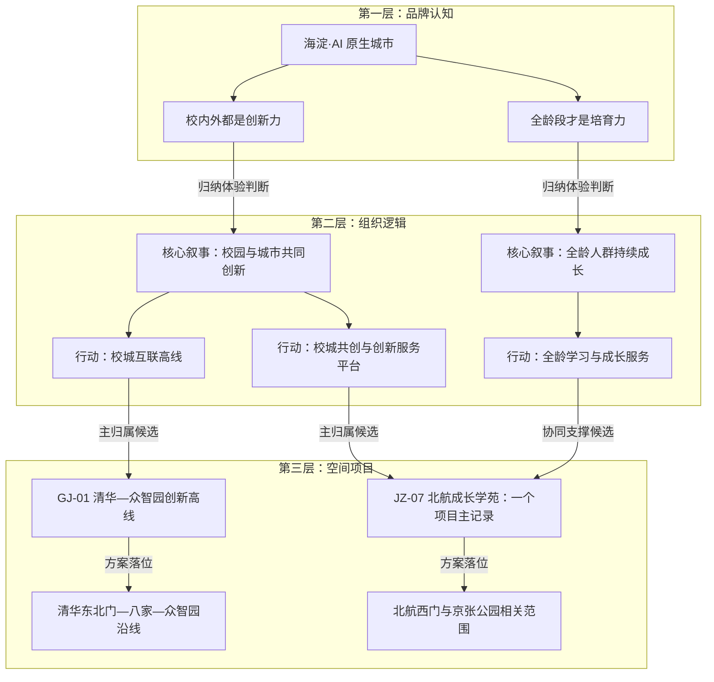

# 从两个真实项目拆出的三层结构样例

本文件用于验证叙事资产架构能否落在现有材料上，并提供后续建模的样本。它不是对原方案的重新审定，也不是原设计团队已经确认的正式资产清单。

方法参照《叙事资产架构说明_通用版_V1.5.md》。品牌认知为第一层，核心叙事与行动计划同属第二层，具体项目与空间单元同属第三层。不得把它们误读成五个独立层级。

## 阅读规则

- **原文明确**：名称、任务、归属或支撑语义在材料中直接出现；本次仍需把它映射到架构类别。
- **据原文归纳**：依据原文重新命名或浓缩，含义有支撑，但句子或独立条目并非原文原有。
- **待确认推导**：关系有合理解释，仍需项目负责人确认，不作为既定归属。
- 上述标记描述本次整理的依据强弱，不能代替“资料事实、研究判断、策划建议”的性质分类。
- 材料中的方案判断仍是方案判断。报告提出不代表审定，设计表达不代表实施；本样例未核实审定、建设或运营状态。
- 页码均为 PDF 文件页序，从 1 开始；关系及条目编号均为本次样例编号。源项目编号另列，不替换。

## 一、东莞：从品牌认知到可参观、可定制的制造体验

来源 `DG-B`：`B-产业策划及资源导入清单-TEKUMA联合体.pdf`。

### 三层对象

| 编号 | 层级 / 类别 | 名称与内容 | 原文位置 | 本次处理 |
| --- | --- | --- | --- | --- |
| DG-V01 | 品牌认知 / 定位依据 | 东莞具有潮玩全生产要素优势，方案希望从制造与供应链优势向 IP 与文旅附加价值延展。性质：原报告研究判断。 | DG-B 8、10 页 | 原文明确；未外部核验产业数据 |
| DG-U01 | 品牌认知 / 人群依据 | 消费者、品牌、设计师和创作者；具体体验中包含研学人群及定制用户。性质：方案设定的服务对象。 | DG-B 4、30 页 | 据原文归纳；未补造年龄或需求调研 |
| DG-M01 | 品牌认知 / 品牌母题 | 东莞潮玩宇宙。母题释义：把制造资源转化为产业创新与文旅体验，形成地方辨识。 | DG-B 4、8、10 页 | 名称原文明确；释义及“品牌母题”归类为本次归纳 |
| DG-E01 | 品牌认知 / 语言表达 | 中国潮玩之都，世界潮玩坐标。 | DG-B 4 页 | 原文明确；作为表达记录，不视为已获认定的称号 |
| DG-N01 | 组织逻辑 / 核心叙事 | 消费者与研学者通过观看生产、参与定制，理解东莞既有制造能力，也能提供智能玩具创新与体验。 | DG-B 8、30、34 页 | 据原文归纳；是预期体验，不是已验证效果 |
| DG-A01 | 组织逻辑 / 行动计划 | 打开前台：在“情绪智能”产品范围内组织透明工厂、私人定制与主题住宿，把生产转化为消费体验。 | DG-B 34 页，三阶段路径第 02 项 | 行动名称与任务原文明确；不将该行动擅自扩大到全片区 |
| DG-P01 | 空间项目 / 具体项目 | 透明超级工厂；源子项目编号 `2-2`。任务含透明生产线、参观走廊、模组演示及研学课程。 | DG-B 30 页，2-2 行；34 页 | 原文明确；本样例作为方案中的具体项目记录 |
| DG-P02 | 空间项目 / 具体项目 | 潮玩柔性生产与私人定制中心；源子项目编号 `2-3`。任务含自助设计、柔性生产、定制与制作过程直播。 | DG-B 30 页，2-3 行；34 页 | 原文明确 |
| DG-S01 | 空间项目 / 空间单元 | 东莞站门户节点；供上述项目定位到片区节点。 | DG-B 19、29–30 页 | 节点归属原文明确；具体地块、建筑边界不由本样例推定 |

### 三层链路图

### 关系记录样例

| 关系编号 | 起点 → 终点 | 关系类型 | 具体贡献 | 依据与位置 | 依据强弱 |
| --- | --- | --- | --- | --- | --- |
| DG-R01 | DG-V01 → DG-M01 | 价值支撑 | 制造及全链条资源为品牌提供地方差异性，文旅用于延展产业价值。 | DG-B 4、8、10 页 | 原文明确 |
| DG-R02 | DG-U01 → DG-M01 | 需求支撑 | 方案把消费者与品牌、创作者共同纳入目的地定位；尚不能替代需求调查。 | DG-B 4 页 | 据原文归纳 |
| DG-R03 | DG-M01 → DG-E01 | 统领表达 | 用语言表达把“宇宙”的产品生态与城市识别联系起来。 | DG-B 4 页末段 | 据原文归纳 |
| DG-R04 | DG-M01 → DG-N01 | 价值传导 | 把制造优势转为可被观看、参与和理解的智能玩具体验。 | DG-B 8、30、34 页 | 据原文归纳 |
| DG-R05 | DG-N01 → DG-A01 | 体验转化 | “打开前台”提供生产参观、私人定制等参与方式，承接叙事中的观看与创造。 | DG-B 30、34 页 | 据原文归纳 |
| DG-R06 | DG-A01 → DG-P01 | 主归属候选 | 透明工厂承担“让生产可见”的任务。 | DG-B 34 页第 02 项；30 页 2-2 行 | 行动包含项目为原文明确；主归属为待确认推导 |
| DG-R07 | DG-A01 → DG-P02 | 主归属候选 | 定制中心承担“让消费者参与生产”的任务。 | DG-B 34 页第 02 项；30 页 2-3 行 | 行动包含项目为原文明确；主归属为待确认推导 |
| DG-R08 | DG-P01 → DG-S01 | 位于（方案） | 把工厂项目对应到东莞站门户节点，尚未记录具体地块边界。 | DG-B 29–30 页 | 原文明确 |
| DG-R09 | DG-P02 → DG-S01 | 位于（方案） | 把定制中心对应到同一节点。 | DG-B 29–30 页 | 原文明确 |

这组样例说明：不必把“情绪智能”这个综合空间产品同时当成核心叙事、行动和具体建筑。应分别保留其原产品语境，并从中识别体验判断、组织任务与子项目。

## 二、京张：同一项目如何承接两种价值与行动

来源 `JZ`：`方案文册（1正19副）.pdf`。

### 三层对象

| 编号 | 层级 / 类别 | 名称与内容 | 原文位置 | 本次处理 |
| --- | --- | --- | --- | --- |
| JZ-V01 | 品牌认知 / 定位依据 | 区域已有科研与创新资源，但高校、院所、企业之间有物理与组织边界，缺少近距离连接机制。性质：原报告研究判断。 | JZ 4、76 页 | 原文明确；不将研究判断写成外部核验事实 |
| JZ-U01 | 品牌认知 / 人群依据 | 科研人员、师生、创业团队及周边全龄使用者。 | JZ 9、17、104、325 页 | 据原文归纳；分别对应协作与终身学习情境 |
| JZ-M01 | 品牌认知 / 品牌母题 | 海淀·AI 原生城市；通过科研、产业、人才与城市资源的组织，提供面向 AI 时代的城市行动条件。 | JZ 4–5 页 | 名称原文明确；释义及母题归类为本次归纳 |
| JZ-E01 | 品牌认知 / 品牌表达与体验原则 | 校内外都是创新力。 | JZ 8–9、76、78 页 | 原文是宣言和设计驱动力；本次将其作为表达与体验要求记录 |
| JZ-E02 | 品牌认知 / 品牌表达与体验原则 | 全龄段才是培育力。 | JZ 16–17、104–105 页 | 原文明确；归类为本次架构映射 |
| JZ-N01 | 组织逻辑 / 核心叙事 | 师生、科研人员与企业通过跨越校园边界的连接、共享与共创，感知创新在校园与城市之间持续发生。 | JZ 9、76、78–79 页 | 据原文归纳 |
| JZ-N02 | 组织逻辑 / 核心叙事 | 不同年龄与职业的人通过学习、公开课、科创实践和交流，把 AI 与持续成长纳入城市日常。 | JZ 17、104–105、301 页 | 据原文归纳 |
| JZ-A01 | 组织逻辑 / 行动计划 | 建设校城互联高线，以连续慢行连接高校、生态空间与产业园区。 | JZ 78–79、324–325 页 | 原文有行动内容；条目名称为归纳 |
| JZ-A02 | 组织逻辑 / 行动计划 | 建设校城共创与创新服务平台，组织孵化、实验和共享交流。 | JZ 9、78、300–301、325 页 | 据原文归纳；原文未单列此名称的独立行动 |
| JZ-A03 | 组织逻辑 / 行动计划 | 配置全龄公共学习与成长服务，将科普、技能与共创活动嵌入日常。 | JZ 17、104–105 页 | 据原文归纳 |
| JZ-P01 | 空间项目 / 具体项目 | 清华—众智园创新高线；源项目编号 `GJ-01`。任务为建立清华东北门、八家郊野公园、众智园间的连续慢行连接。 | JZ 79、324–325 页 GJ-01 行 | 原文明确 |
| JZ-P02 | 空间项目 / 具体项目 | 北航成长学苑；源项目编号 `JZ-07`。包括孵化、实验、图书、公共服务及活动空间，兼顾创新与终身学习。 | JZ 104–105、300–301、324–325 页 JZ-07 行 | 原文明确；只建一个项目主记录 |
| JZ-S01 | 空间项目 / 空间单元 | 清华东北门—八家郊野公园—众智园沿线。 | JZ 324–325 页 GJ-01 行 | 方案线位原文明确；边界待专项核定 |
| JZ-S02 | 空间项目 / 空间单元 | 北航西门和京张铁路遗址公园内的相关范围。 | JZ 324–325 页 JZ-07 行 | 方案位置原文明确；不替代用地与授权文件 |

### 三层链路图

图中行动拆分及主归属、协同关系均为建模建议；原文没有使用这些样例编号。原文明确的是：北航成长学苑在项目清单中标为“校内外都是创新力”，且在全龄公共服务章节中再次出现。

### 关系记录样例

| 关系编号 | 起点 → 终点 | 关系类型 | 具体贡献 | 依据与位置 | 依据强弱 |
| --- | --- | --- | --- | --- | --- |
| JZ-R01 | JZ-V01 → JZ-M01 | 价值支撑 | 从资源组织与边界问题出发，支撑 AI 原生城市的定位。 | JZ 4–5、76 页 | 据原文归纳 |
| JZ-R02 | JZ-M01 → JZ-E01 | 统领表达 | 将资源协同转为校城创新的宣言与设计驱动力。 | JZ 4、8–9、74、78 页 | 据原文归纳 |
| JZ-R03 | JZ-M01 → JZ-E02 | 统领表达 | 将人的能力与全龄进化转为持续成长的体验要求。 | JZ 5、16–17 页 | 据原文归纳 |
| JZ-R04 | JZ-E01 → JZ-N01 | 体验指引 | 通过开放、共享与共创，让创新跨越校园边界。 | JZ 9、78–79 页 | 据原文归纳 |
| JZ-R05 | JZ-E02 → JZ-N02 | 体验指引 | 通过学习与公共活动，让不同人群在城市日常中成长。 | JZ 17、104–105 页 | 据原文归纳 |
| JZ-R06 | JZ-N01 → JZ-A01 | 体验转化 | 连续慢行连接为高频人才与知识交流提供空间条件。 | JZ 79 页高线说明 | 据原文归纳 |
| JZ-R07 | JZ-N01 → JZ-A02 | 体验转化 | 孵化、实验与交流载体为校城共创提供服务条件。 | JZ 9、300–301、325 页 | 据原文归纳 |
| JZ-R08 | JZ-N02 → JZ-A03 | 体验转化 | 用公开课、AI 通识与技能活动组织持续学习体验。 | JZ 17、104 页 | 据原文归纳 |
| JZ-R09 | JZ-A01 → JZ-P01 | 主归属候选 | 创新高线承担跨边界的连续慢行连接任务。 | JZ 79、324–325 页 GJ-01 行 | 任务为原文明确；主归属待确认 |
| JZ-R10 | JZ-A02 → JZ-P02 | 主归属候选 | 成长学苑的孵化、实验与交流功能承担创新服务任务。 | JZ 300、324–325 页 JZ-07 行；原表“五力维度”为校内外都是创新力 | 任务与维度原文明确；转为行动主归属待确认 |
| JZ-R11 | JZ-A03 → JZ-P02 | 协同支撑候选 | 同一学苑提供终身学习与公共活动，不新增第二条项目记录。 | JZ 17、104–105、301 页；325 页 JZ-07 行 | 跨章节贡献原文明确；关系分类与优先序待确认 |
| JZ-R12 | JZ-P01 → JZ-S01 | 位于（方案） | 项目对应清华东北门—八家—众智园的沿线。 | JZ 324–325 页 GJ-01 行 | 原文明确 |
| JZ-R13 | JZ-P02 → JZ-S02 | 位于（方案） | 学苑对应北航西门与京张公园相关范围。 | JZ 324–325 页 JZ-07 行 | 原文明确 |

### 这个多对多样例应如何理解

原文的“五力维度”是项目分类依据，并不等同于已经定义好的行动计划。在本样例中，先保留原维度字段，再提出行动层的主归属与协同候选，交由项目负责人确认。

若未来按行动统计项目，候选主归属未确认前不要强行计数；确认后，同一项目只在主归属中计一次，其余贡献通过关系表保留。当前样例不据此计算投资、面积或项目总数。

## 三、可直接复用的最小模板

后续先用两张表和一份来源索引即可，不要求一次补齐反馈、修订或运营信息。

### 对象表

| 项目 | 资产编号 | 层级 | 类别 | 名称 | 内容 / 预期体验 / 任务 | 原项目编号 | 判断性质 | 整理依据 | 方案确认情况 |
| --- | --- | --- | --- | --- | --- | --- | --- | --- | --- |
| 待填 | 稳定且唯一 | 品牌认知 / 组织逻辑 / 空间项目 | 母题 / 核心叙事 / 行动 / 项目 / 空间等 | 保留原称或注明归纳名 | 含人群、条件与范围 | 无则留空 | 资料事实 / 研究判断 / 策划建议 | 原文明确 / 据原文归纳 / 待确认推导 | 未核实 / 有依据的正式结论 / 不适用 |

### 关系表

| 关系编号 | 起点编号 | 关系类型 | 终点编号 | 具体贡献 | 判断性质 | 整理依据 | 归属确认情况 |
| --- | --- | --- | --- | --- | --- | --- | --- |
| 稳定且唯一 | 对象表编号 | 价值支撑 / 体验指引 / 体验转化 / 主归属 / 协同支撑 / 位于等 | 对象表编号 | 谁通过什么，支撑对方的哪一部分 | 与两端对象分别判断 | 原文明确 / 据原文归纳 / 待确认推导 | 候选 / 已有依据确认 / 不适用 |

候选记录中，“主归属候选”是关系类型“主归属”与确认情况“候选”的便捷显示，不能冒充正式归属。

### 来源与引证

| 来源编号 | 资料名称与版本 | 资产或关系编号 | 支持的字段 / 判断 | PDF 页序与段落 / 表行 | 原文摘要 / 依据说明 |
| --- | --- | --- | --- | --- | --- |
| 待填 | 一份资料的一个版本 | 可引用对象或关系 | 不只给整份项目挂来源 | 如：第 325 页，JZ-07 行，更新目标列 | 保留明确支持范围，不把来源的存在当作推导已经被证明 |

### 首轮整理检查

1. 是否至少有一条可追溯的“母题—叙事—行动—项目”链路，且叙事与行动同属第二层？
2. 叙事是否说清楚“谁、通过什么体验、理解什么地方价值”？
3. 行动是否提供了实现体验的具体条件，而不只是重复品牌口号？
4. 项目是否有任务；空间单元是否记录位置，而未混为同一对象？
5. 每条关系是否说明了具体贡献与依据，并标出推导？
6. 同一项目是否只有一个身份；主归属未确认时是否明确留待确认？

## 四、需要负责人确认的最少事项

- 两个品牌名称是否适合作为母题，释义是否准确。
- 本次归纳的核心叙事是否表达了原团队的设计意图与主要服务人群。
- 东莞“打开前台”的行动边界，以及子项目的主归属。
- 京张行动的拆分粒度，北航成长学苑主责与协同贡献的划分。
- 方案确认情况、具体空间边界和实施进度；这批材料本身不足以证明当前状态。

本文件只提供可发展为模板的选取样例，不把缺少的运营反馈或确认记录补写为事实。
